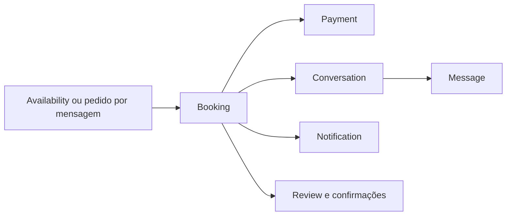

# Arquitetura

Este documento resume os limites entre interface, regras de domínio e persistência. Para os estados detalhados de vídeo e perguntas por mensagem, consulte [Fluxos de conversa](docs/CONVERSATIONS.md).

## Stack e responsabilidades

| Camada | Local | Responsabilidade |
| --- | --- | --- |
| Rotas e interface | `src/app`, `src/components` | Páginas Next.js, Server Actions e componentes interativos. |
| Domínio | `src/lib` | Papéis, políticas de booking, formatação, sessão, moderação e integrações externas. |
| Persistência | `supabase/migrations`, `supabase/baseline` | Tabelas, RPCs, gatilhos, RLS, índices e evolução do esquema. |
| Operações isoladas | `supabase/functions` | Edge Functions, incluindo a exclusão de conta. |

Next.js usa App Router e Server Components por padrão. Acesso privilegiado ao Supabase fica no servidor. O navegador usa a chave publicável e só acessa dados permitidos pelas políticas RLS.

## Identidade e autorização

- `auth.users` autentica a sessão.
- `public.User` representa a pessoa e seu papel cadastrado (`USER`, `CONSULTANT` ou `ADMIN`). Uma pessoa consultora também pode usar o painel de cliente.
- `ProfessionalProfile` é o perfil profissional, separado da identidade da pessoa.
- `Booking.customerId` identifica quem agenda; `Booking.professionalProfileId` identifica o perfil escolhido.
- RPCs privilegiadas derivam a identidade de `auth.uid()` e verificam papel e participação. A interface não é uma fronteira de segurança.
- O service role é usado apenas em código server-side e nunca é exposto em variáveis `NEXT_PUBLIC_*`.

## Domínio de conversas

Um booking tem um formato (`VIDEO` ou `MESSAGE`). Os dois formatos compartilham reserva, pagamento, histórico, suporte e avaliação, mas têm regras próprias de início e encerramento. O detalhe operacional está em [docs/CONVERSATIONS.md](docs/CONVERSATIONS.md).

## Atualizações em tempo real e leitura

- Mensagens usam Supabase Realtime para atualizar o chat aberto.
- `Message.readAt` registra quando o participante leu cada mensagem recebida; esse mesmo recibo alimenta os contadores de mensagens não lidas.
- `ConversationRead` mantém o último acesso da pessoa à conversa.
- Ao abrir uma conversa, as notificações ligadas àquele caminho também são marcadas como lidas.
- As consultas de uma conversa verificam primeiro se a pessoa é cliente ou consultora participante antes de ler o conteúdo com acesso server-side.

## Rotas centrais

| Área | Rotas |
| --- | --- |
| Cliente | `/dashboard`, `/dashboard/agendamentos`, `/dashboard/mensagens`, `/dashboard/avaliacoes` |
| Consultor | `/consultor`, `/consultor/consultas`, `/consultor/ganhos` |
| Conversa | `/conversa/[id]`; videochamada em `/consulta/[id]` |
| Administração | `/admin/*` |
| Automação | `/api/cron/*`, webhooks em `/api/webhooks/*` |

## Banco e migrations

- `supabase/baseline/schema.sql` registra o esquema-base legado.
- `supabase/migrations` contém as alterações incrementais e é a fonte das versões recentes do banco.
- Neste projeto, o histórico remoto tem migrations aplicadas por caminhos diferentes; siga o procedimento de aplicação isolada descrito no [README](README.md#banco-de-dados-e-migrations), em vez de presumir que `db push` pode reaplicar todo o histórico.
- Tipos gerados para a Data API ficam em `src/lib/supabase/database.types.ts`. Algumas tabelas ou colunas adicionadas mais recentemente ainda são consultadas com tipos locais explícitos até a regeneração.

## Pagamentos

O checkout ativo é demonstrativo e não movimenta dinheiro real. O código contém a integração Stripe para evolução futura; webhooks, transferências, reembolsos e confirmações precisam respeitar os contratos server-side descritos em [docs/PAYMENTS_AND_TRANSFERS.md](docs/PAYMENTS_AND_TRANSFERS.md).
